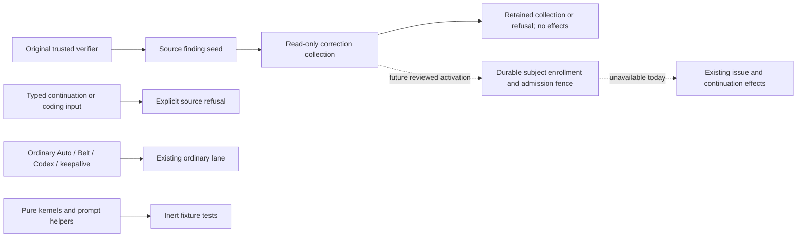

# Correction interface deployment boundary

This release retains the original verifier seed, read-only request collection,
public v1 schemas, pure effect/reconciliation kernels and inert tests. It does
**not** deploy typed issue creation, continuation or coding. The effect job has
an unconditional false condition, production effect/continuation factories refuse
before native I/O, Auto rejects a supplied typed selector before ordinary effects,
and the actual runner CLI refuses an unsupported correction sidecar before writing
a provider prompt. No variable, caller field, role record or credential can enable
this source policy. Activation requires another reviewed source change.

Ordinary Auto, Belt, Codex, keepalive and merged-PR label follow-up no longer call
repository-wide correction-history discovery. Their ordinary routing, stop
controls and provider behavior are preserved. The legacy label follow-up job is
byte-identical to its canonical pre-interface version. Pure helpers retain strict
UNKNOWN/reconciliation semantics for offline tests; removing a live dependency
is not permission to reinterpret a genuine uncertain effect.

## Why no historical migration is needed for this producer

The audit covers this new typed producer only, not arbitrary legacy issue work.
Its code was introduced on the unmerged #4264 branch. The first effect kernel was
pure; every later authored workflow omitted `authenticateDecision`, which the
collector requires before emitting admitted status. The first effect job required
that unreachable status. Branch executions also cannot authenticate their own
canonical default-branch origin; reruns retain the original branch identity and
cannot inject the omitted callback.

The read-only deployment audit found all 17 registered canonical workflow copies
at Git blob `50ca772edbf5150f226d5db4f39333324d43b6b9`, without typed inputs/jobs,
and no recorded typed dispatches. #4264 remained unmerged. These actual deployed
versions plus source unreachability establish that this selected producer has not
created an unresolved typed effect. The empty run inventories are supporting
observations, not a universal assertion about deleted records or legacy work.
Exact repository commits, workflow hashes and introduction commits are recorded in
[the lineage audit](../evidence/verifier-correction-inert-split/deployment-lineage.json).

## Current and future paths

## Bounded subject-index design, not deployed

The minimum proposed namespace is `refs/heads/closer-correction-state`, with
`.github/closer-correction/index.json` and schema
`closer-correction-subject-index/v1`. This is a correction-discovery record in the
existing repository, not another scheduler, role registry or authority service.
It must never read or modify keepalive challenge records as correction authority.
`keepalive_authority_state.js` provides useful storage patterns: prior-blob-SHA
conditional writes, exact readback, immutable commit/tree reads and presence
checkpoints. It does not supply a complete correction enrollment protocol.

A bounded index would contain repository identity, an independently established
bootstrap epoch, revision/predecessor, stable seed effect keys, native issue/PR
node identities, exact admitted/ledger selectors, original limits and unresolved
stage fences. Membership is append-only. Explicit size/count saturation holds;
there is no truncation, reset, automatic rollover or negative cache expiry.
Positive membership discovers the authenticated scope; it grants no role, ACT,
source closure or permission to replace the original issue body.

Required causal order:

1. Authenticate the existing seed/request and fresh lane/owner gates.
2. Enroll the authenticated source PR/linked source issue and any existing
   incumbent's native identity under the effect key, with conditional write and
   confirmed readback **before** any effect intent.
3. For no-incumbent creation, retain an unresolved-creation fence **before** POST.
   A lost creation response has no known issue ID. It must not disappear from the
   index or permit a new create. Retain that conservative fence until native
   response/reconciliation establishes the exact issue node and scope.
4. Retain native creation identity, then confirm its index mapping before ordinary
   activation or continuation dispatch. Preserve the separate dispatch intent and
   uncertainty under the same seed key.
5. Enroll a coding PR's exact native identity before any later independent entry
   can omit mandatory scope. Ordinary readers use a pinned current index snapshot
   and direct subject lookup, not every historical Actions artifact.

An index miss is ordinary only under a valid bootstrap/completeness contract and
an admission fence shared by typed and ordinary writers. Missing branch/bootstrap,
invalid or incomplete state, unresolved applicable creation, revision conflicts,
lost write acknowledgements and missing expected membership remain UNKNOWN.
A genuine unknown new-issue creation can conservatively hold multiple possible
new subjects; the index cannot invent an exact issue identity to avoid that cost.
Fresh native issue identity and a strictly earlier native issue creation time
can exclude that issue from being the unknown new issue created by this specific
POST. This proves only that narrow exclusion, not absence of other correction
obligations. An older PR can later be associated with a newly created issue; its
creation time alone cannot exclude inherited scope. Caller clocks, labels or body
text cannot provide an exclusion. Source/incumbent enrollment and other applicable
unknown stages remain independently binding.

Two problems must be solved before claiming safe activation:

- **Delayed ordinary execution:** checking active Actions runs or reading the index
  twice is insufficient. Belt activation comments can queue work that outlives
  the worker. The actual coding consumer must recheck immediately before execution,
  or its ordinary activation reservation must remain until positively reconciled.
- **Whole-ref rollback:** SHA-CAS and no-force writes prevent the controller's own
  stale updates. A checkpoint on the same branch cannot detect deletion followed
  by recreation of an older valid branch snapshot. A separately authenticated
  monotonic high-water anchor or an explicitly reviewed/enforced writer trust
  boundary is needed. A self-hash is not that anchor.

The current effect job has `contents: read`. An index writer therefore needs an
exact reviewed write boundary: either an explicitly scoped operation in an
existing authorized writer, or a separately approved permission change. Existing
keepalive write permission and challenge authority are not implicitly available.
No such operation, permission, credential or remote state is created by this
release. The design remains inert until write, rollback and final-consumer race
requirements have causal tests and source review.
