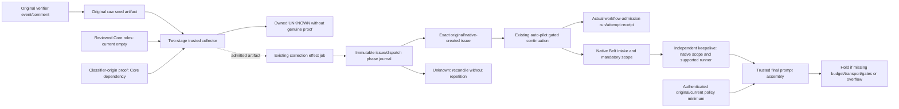

# Closer correction interface — local inert implementation

This bounded interface extends the existing merged-PR follow-up issue and
`agents-auto-pilot.yml` lane. The verifier seed, two-stage admission, durable
phase ledger, issue/autopilot consumer, reconciliation and actual started/redispatch
receipts are source-wired and tested with inert effects. **Production handoff
remains UNMET**: Core's genuine classifier-output authentication is unavailable,
its reviewed production role registry is empty, and final coding requires an
explicit configured prompt budget. No new scheduler, provider, store or authority
service is added. Publication does not install, qualify, dispatch or merge this code.

## Frozen local contract and fixtures

The validator is `.github/scripts/verifier_correction_consumer.js`; effect-side
logic is `.github/scripts/verifier_correction_effects.js`. All files under
[`tests/fixtures/verifier_correction`](../../tests/fixtures/verifier_correction/)
are synthetic, not claims about real GitHub provenance or workflow execution:

- `request.json`: unchanged existing-incumbent request.
- `no-incumbent-request.json`: declared `incumbent: {kind: "no_incumbent"}`;
  fabricates no issue ID, owner or assignment.
- `seed.json`: original verifier source/finding/event scope, excluding later
  Closer operation, incumbent and required-test decision fields.
- `no-incumbent-ownership.json`: synthetic trusted collector output.
- `accepted-no-incumbent-receipt.json`: synthetic exact issue/run/attempt receipt.

Canonical JSON uses `verification_event.canonical`: sorted keys, UTF-8, no
whitespace, significant array order. Request/receipt hashes exclude their own
`request_sha256` / `receipt_sha256` fields. Ledger record hashes likewise exclude
`record_sha256`. Declared requester context is bound by the request digest, never
promoted into externally attested Closer hold authorization.

`closer-correction-request/v1` binds target repository/PR/head/base/merge, linked
source issue node/body, original verifier event/run/attempt/comment/decision,
exact raw finding reference/content hash, typed required tests, declared incumbent,
original operation/hold/run/idempotency/deadline/budget/escalation and
`scope: substantive_implementation`. Unknown request fields are refused.

Required tests are data, never executable commands:

- `existing_selector`: ID/finding ID, immutable source ref, relative physical test
  path, selector and file hash.
- `required_test_spec`: ID/finding ID, exact implementation specification and
  source-evidence ref/content hash matching the finding evidence.

The later trusted collector authenticates these requirements against the actual
source-bound correction decision. The original verifier seed does not assert
future Closer operation IDs or future test specifications. The effect adapter
checks both the original seed and the separately collected required-test decision;
changing a request's test prose cannot bypass this check.

## Two-stage authentication and ownership

The original verifier cannot authenticate Closer IDs created after its terminal
result. It retains a source finding/event seed beside its existing terminal
report/result artifacts. The existing correction workflow's trusted collector
then validates a bounded post-terminal request against that seed plus fresh
GitHub actor permissions, source/owner/assignment/review/run/policy facts.
Caller JSON booleans and declared local hold IDs supply no remote authority.

The trusted host output `closer-correction-ownership/v1` has `kind` equal to
`existing`, `no_incumbent` or `unknown`, plus `seed_effect_key`,
`source_scope_digest`, `observed_at`, `evidence_refs`, and an exact `incumbent`
only for `existing`. It is a result of authenticated collection, not an additional
caller input accepted as truth.

Existing requests must match the freshly observed exact issue/owner/assignment/
lineage. No-incumbent creation requires the explicit caller variant AND an
independently collected matching no-incumbent result. Complete linked follow-up
issue/open-PR/assignment/run and retained-effect history must show no incumbent,
unknown/starting/denied effect or competing work. Missing/unread/incomplete evidence
is unknown, never no-incumbent. Caller nulls and contradictory declarations refuse.

The effect key hashes the original event, raw finding evidence pointer/content,
source issue identity/body and scope. Caller request/hold/run/idempotency IDs,
display finding IDs and mutable assignment do not change it. `source_scope_digest`
binds target/source/raw finding/scope. These functions are frozen in the effect
helper; the shared fixture fixes their cross-language expected values.

## Existing issue/autopilot effects and reconciliation

The effect adapter has mandatory trusted-host dependencies and no live defaults:
original-seed/request/test-decision authentication, fresh facts, complete
existing-follow-up-ledger reads, durable conditional ledger append, authenticated
issue/started-receipt reconciliation, the existing GitHub client and a clock.
The separate conditional effect job consumes its own retained admitted artifact;
the collection job performs no issue or dispatch effects.

Both fixed stages share one trusted effect key:

1. `issue_creation`: conditionally retain the exact intent before calling the
   existing issue endpoint once. Recover only one exact original issue/node/body
   native HTTP201 response (exact issue/node/body/creator/request ID), then
   durably retain that response proof and identity before dispatch. A copied body
   marker, matching bot author or creation time cannot recover a lost native
   creation response. That case remains UNKNOWN, without another create call.
2. `autopilot_dispatch`: after fresh created-issue/competing-work checks,
   conditionally retain the separate intent before calling existing
   `agents-auto-pilot.yml` with `issue_number` and `force_step=optimize` once.

Existing incumbents skip creation. Registry-derived agent/from/runner labels are
preserved; no generic model qualification creates authority. The typed creation
branch omits the `agents:auto-pilot` trigger label because explicit dispatch owns
activation; adding that label would also start a label-event run. The legacy
label-triggered implementation remains in place. A complete retained-history fence
holds its source PR, and unscoped auto-pilot holds an authenticated incumbent
issue, when a typed correction may already own the same work.

Every stage refuses to invoke an effect without a confirmed durable intent.
Conditional revision checks and a per-stage existing-intent check prevent duplicate
calls, including concurrent consumers advancing between issue retention and
dispatch. Shared token-aware API wrapping preserves the supplied scoped client;
consequential calls set both wrapper `maxRetries: 0` and SDK `request.retries: 0`
with a bounded timeout. This also disables the SDK retry layer documented by
[Octokit](https://github.com/octokit/plugin-retry.js/blob/main/src/error-request.ts). Lost intent acknowledgment invokes no endpoint. Unknown stage outcomes
never automatically repeat. An exact positively recovered issue permits the
first dispatch, not a replacement issue. Uncertain dispatch requires the actual
started receipt; HTTP204, issue creation, a run title or missing logs do not prove
acceptance. Later deadline expiry or refusal cannot erase an existing uncertainty.
The clock is checked before collection, after fresh gates and after intent
retention immediately before the consequential endpoint.

Fresh gates preserve the merged target, source/issue body and node identity,
incumbent assignment/lineage, pause/needs-human/failure labels, chain limit below
two, verdict policy, enabled registry agent where needed, write-capable dispatch
actor and complete competing-work inventory. Existing live incumbent work is
reconciled without dispatching a second writer. Security/conflicting-authority
scope remains outside this substantive correction lane.

`closer-correction-receipt/v1` distinguishes `confirmed_not_started`,
`accepted_with_exact_issue_and_actual_autopilot_run_attempt` and `outcome_unknown`.
It retains the original declared request/digest and consumer run/attempt. An
additive `ownership` contains the trusted collector's bound proof context. For
no-incumbent ownership, actual created issue/node may differ from the declared
request, which contains no invented issue identity. Plain legacy receipts retain
existing-incumbent equality. Shape validation is not provenance authentication:
the host must authenticate collector and started-artifact run/attempt/origin.
All receipts set retry/ACT/source-closure authority to false. No handoff clears
NON_PASS, resolves the finding or proves required-test success.

## Intermediate collection entrypoint and integration gaps

The existing `agents-verify-to-new-pr.yml` accepts the original
`closer-correction-selector/v1` plus optional bounded `correction_request` and
`correction_decision` JSON inputs. The two-stage collector authenticates the
original artifact through `acquireRetainedExecution`, reproduces every raw seed
from retained output, original execution receipt, native terminal comment and
current GitHub subject/source APIs, and verifies physical existing-test hashes at
an exact subject commit. It retains its own `closer-correction-admitted/v1`
context in `verifier-correction-admitted-RUN-ATTEMPT`. The earlier selector-only
single-artifact collection path is retained as an intermediate compatibility path.

The original producer now writes `closer-correction-seeds.json` beside the
existing evaluate/compare artifacts after authentic terminal publication. It
asserts only original event/run/attempt/comment, raw finding and exact source/PR
identity. It never asserts future hold, operation, owner or required-test data.
Ambiguous retained source, unavailable provider slots, absent explicit findings
or changed source bytes produce a bounded refusal, not invented evidence.

`verifier_correction_profile.py` reads a literal-only view of the existing
`stranske/Orchestrator` `src/closer_role_qualification.py` registry. The host fixes
repository/default reviewed ref, fetches an exact commit and verifies Git blob
integrity. The parser never imports or executes fetched code. A reviewed-reader
AST fingerprint excludes only the registry literal; changed semantics, dynamic or
ambiguous source, revoked/expired records and the current empty registry remain
UNKNOWN. This is role-record eligibility, not runtime/provider confinement proof.
Core independently compared the shared 16-case fixture against its actual
`qualification_problems` reader: 16 matches, zero mismatches. The fixture SHA256 is
`bad0bbd5dbe2e3c8a621043f4c10b67373a0c57d437b97fc9c6b1d09bbf3ba72`.

Qualification does not prove a profile emitted supplied classification JSON.
The collector therefore separately requires a trusted retained-I/O decision
verifier, binding decision digest and exact profile identity. That Core supervised
execution/native collector join is not available yet; nonempty caller evidence
references cannot substitute. The workflow currently passes no such verifier and
therefore retains owned UNKNOWN contexts, even if a future registry record exists.
Security/authority-conflict/uncertain findings never enter generic auto-pilot.

The Actions-artifact transport and NDJSON journal implementation are now source
code with inert causal tests. Each stage uploads a fixed immutable checkpoint and
checks actual canonical workflow/run/attempt/job/step/archive/member provenance
and exact readback before effects. Complete retained history, contiguous revisions
and first-request limits are required. Missing/deleted historical checkpoints
remain UNKNOWN unless the exact historical effect job was positively skipped;
expiry, forks, duplicates and upload uncertainty cannot imply absence. These
artifacts require the authenticated PR concurrency host integration; they are not
a new store or a cross-workflow lock. The existing official Actions artifact SDK
is installed only on the admitted correction branches using its private checked-in
package manifest and full integrity lock with install scripts disabled. The exact
runtime module/export was checked after a cold offline install; no SDK method or
GitHub effect was invoked. The operational Auto workflow retains its original
Workflows-only PR-meta/keepalive fallbacks, while the consumer keeps its consolidated
entry points. Shared correction hunks do not erase that existing routing difference. The source effect job shares the original
repository/PR concurrency group. Its fresh native collector includes all relevant
nonterminal Actions states; missing assignment/queue evidence remains owned UNKNOWN.
A native assignee event and versioned strict cross-reference content projection bind
existing ownership. Cross-referenced events have no numeric event ID; mutable issue
body/labels never become lineage identity. Connected events are joined using their
actual native GraphQL source/subject nodes, not invented REST fields.

Auto-pilot accepts an optional `closer-correction-continuation-selector/v1`, bound
to the admitted collector artifact and exact dispatch-intent revision. Actual
should-continue/step/cycle/rate gates precede a retained started receipt, followed
by a fresh recheck. Every provider branch and redispatch requires this retained
admission. Started means workflow admission; it does not attest provider start.
Prepared redispatches preserve the original request/issue/node/intent and retain
post-step observed body separately. Native PR creation HTTP201 is retained before
owned-PR monitoring; another PR is not silently adopted. The correction formatter
holds before model dispatch because its existing implementation replaces the issue
body; it is not counted as delivered correction work. Unreachable typed formatter
pause/wakeup workflow branches are removed; ordinary formatting and its existing
wakeup path remain intact. Pure formatter proof helpers grant no active producer
or dispatch capability.

Core retains Orchestrator #944 integration ownership. Gate and caller hardening
remain outside this slice.

## Mandatory finding/test delivery

The admitted context retains the exact original raw `finding_text` and all typed
`required_tests`. Optimize/apply receive this as separate data together with the
complete original body. They bypass the legacy embedded-original reset and
truncating fitter. The actual rendered template is measured using existing
`ContextOptions`/`estimate_tokens` and the optimizer's configured budget before any
client is created. Typed apply never updates the incumbent issue body, including
with an old identical copy that could overwrite a concurrent human edit.

Belt's actual activation caller and final Codex runner independently discover
scope using complete retained admission/ledger history and exact native issue
identity. Historical native cross-references join the coding PR ID/node/repository;
removing `Closes` or changing PR text cannot erase a known mandatory scope. Neither
queue JSON nor mutable text supplies authority. Missing/expired/ambiguous history
holds. Intake rechecks current qualification, source/incumbent holds, exact source
and owner/assignment/lineage, original actor permission, verdict policy and deadline.
The final provider step repeats the fresh admission check.

`closer-correction-coding-context/v1` carries the authenticated admitted selector,
original request/effect/issue identity, complete original issue body, finding text
and typed test descriptors. The existing Belt activation text and final runner
prompt append this data without replacing the incumbent appendix. Mandatory data
never follows the optional keepalive appendix's continue-on-error path.

The final coding lane previously had **no configured token budget**. Correction
runs require an explicit positive `ISSUE_PR_CONTEXT_TOKEN_BUDGET` repository variable;
absence is `correction_budget_unconfigured`. The actual assembled prompt, including
provider instructions, base prompt, appendix, guidance and mandatory scope, is
checked with the existing estimator. Overflow is `correction_scope_over_budget`,
before the coding/provider caller; no source, finding or test is silently dropped.
This is an estimated-token admission bound, not a universal provider context claim.
Correction assembly is loaded from a separate reviewed `main` Workflows checkout,
moved outside the target tree, rather than a stale or PR-edited consumer module.
Absent correction scope preserves the existing prompt bytes and ordinary path.

## Local validation checkpoint

The source checkpoint adds native consumer/continuation/ownership and mandatory
prompt suites to the existing correction tests, including 36 Python final-template
and final runner-file cases plus the 33 qualification source-reader cases. Exact
command counts are recorded with the reviewed publication head rather than treated
as deployment evidence. All consequential effects are inert; artifact
transport tests use independently generated ZIPs and mock Actions/SDK boundaries. Cases
include accepted existing and no-incumbent requests, deterministic refusal,
HTTP204 versus actual run identity, uncertain create/dispatch, exact issue recovery,
restart, lost checkpoint acknowledgments, changed caller IDs, complete fresh
ownership/labels/work inventory, deadline changes and concurrent requests.
Ten concurrent consumers produce one issue and one dispatch in the inert fixture.

Local adversarial review found and fixed incomplete work-inventory admission,
invalid consumer identity before invocation, post-intent deadline expiry, malformed
prior-started proof handling, and a possible second-stage race after concurrent
issue retention. Independent read-only review additionally found a copied-marker
issue substitution and regex coercion of digest arrays; both were fixed and
regression-tested, including accepted-continuation binding and strict scalar types.
Final source mutants detect removal of the fixed-stage fence,
durable intent and current-assignee check; the unmodified source remains green.
No production issue, label, workflow dispatch, provider call or source closure
is exercised by these tests.

Hosted scanner review tightened the new checkout with `persist-credentials: false`
and corrected the artifact action pin/version. The local composite `./` reference
is intentional: it resolves from the explicit Workflows checkout in consumers,
whereas self-repository syntax would select the consumer repository/version. The
path-join audit annotation is a false positive: `directory` is the host workspace
literal `'.'`, never selector input; the filename is fixed and the authenticated
helper just created it using `wx`. These boundaries were independently reviewed;
no broad suppression, hosted alert dismissal or security-policy change is made.

The current integration checkpoint additionally covers original raw-seed
production, two-stage collection, role-source integrity, deleted/expired/forked
checkpoint history and post-checkpoint fresh admission gates. Hosted Python checks
on the previous PR head exposed stale generated Renovate ownership paths and a
hardcoded managed-entry count; both are corrected locally with focused regression
checks before publication. Hosted status must be read at the next exact PR head.

## Classifier origin: identified producer and exact missing boundary

Read-only inspection of Core's controlled-origin candidate `7a7ef1f0d51c14e6c04d8b2a691c3eb25db329eb`
identified the actual local producer, rather than an unspecified attestation:

| Existing component | Evidence it actually supplies | Boundary it does not cross |
| --- | --- | --- |
| `src/dispatcher.py::_controlled_data_only_entry`, `offload`, `_retain_provider_result` | Supervised start/finish callbacks, exact launch/config/source/prompt bindings, raw native response, create-only `offload-provider-result/v1` receipt under `HANDOFF/dispatch-logs/<run>.provider-result-<attempt>.json` | A Mac-local file/hash is not an authenticated GitHub producer |
| `src/closer_dispatcher.py::_controlled_offload`, `_validate_controlled_result`, `_revalidate_controlled_proof` | Joins original expected/observed stage, physical receipt, original pool/run/operation, exact production contract and native final; produces `closer-controlled-response-proof/v1` with `authority: false` | Its own contract explicitly disclaims remote Workflows decision authentication |
| Existing `reusable-claude-run.yml` | A real Actions runner, existing Claude credential inputs and output-artifact upload | Its current agentic command and write/commit path do not implement the controlled classification contract |
| Existing `reusable-model-profile-trial.yml` | Native Actions provenance for a fixed read-only identifier canary | Its strict artifact is not a classifier output and its instrumentation contract forbids using it as evaluator authority |

The bridge is **absent**, not merely an existing signed record awaiting a reader.
No production bounded-classification observation or qualified record exists.
The controlled producer supports a pinned local Mac Claude binary (`c9b534...`);
that qualification cannot cover a hosted Linux CLI or a different OAuth account.
The local records above are source-bound execution evidence, not newly invented
signatures, HMACs or a remote publisher.

Core owns those local producer and semantic-materialization files. This slice owns
`collectSubmission`'s strict host consumer and coding-budget carry. A change to
`reusable-claude-run.yml` needs a single-writer assignment for the proposed optional
isolated data-only arm; no such hunk is edited here. Reusing its ordinary agentic
command, importing a Mac receipt, or promoting capability-evidence input strings
would not close the boundary.

The smallest proposed producer-to-consumer contract is one retained artifact from
that **actual** bounded invocation in the existing workflow, after its exact
hosted binary/profile/account/role is supported:

The hosted arm also needs a genuine existing account/capacity-pool reservation
binding and a durable pre-start operation intent with exact readback before any
provider invocation. A fresh runner-local empty pool is not proof of shared account
capacity, and a lost artifact/process outcome must not launch a replacement model
call. Reusing Core's existing admission/retention mechanisms is required; no new
budget, account mapping or caller-asserted pool reservation is inferred.

1. The producer receives the authenticated seed and bounded post-terminal request;
   it retains the complete actual classification prompt (not only a snippet or
   self-asserted hash), checked for credential exclusion before hashing/retention.
2. Its existing supervised dispatcher produces the original expectation and
   start/started/finished observations, complete provider-result receipt and raw
   native final. All original pool/run/operation/profile/prompt/config/binary/source
   and cleanup bindings must join. These existing records retain their own schemas.
3. Core's existing semantic validators and a reviewed deterministic materializer
   derive the exact `closer-correction-decision/v1` from that native result plus the
   source-bound request/test requirements. Missing explicit requirements or risk
   evidence remains collection; the producer must not manufacture tests or security
   clearance. The materializer's reviewed source identity is retained.
4. The artifact binds `request_sha256`, `seed_effect_key`, `source_scope_digest`,
   original verifier event/finding, exact typed tests, decision digest and profile
   identity digest. Complete prompt/receipt/raw-final bytes may be nested once;
   independent member hashes must not replace the retained source bytes.
5. The consumer host retrieves only an allowlisted **assigned actual producer**
   through native Actions repository/workflow/default-source/run/attempt/job/step/
   artifact/member provenance and exact digests, then validates those joins and
   current role qualification. Caller-selected URLs, local paths, JSON booleans,
   capability refs and canary output never supply that provenance.

No actual producer path/job/step locator is fabricated before assignment and
implementation. The existing host callback remains
`authenticateDecision({decision, qualification, request, seed, bundle})`; only a
successful genuine host join may return `status: authenticated` with the exact
`decision_sha256` and `profile_identity_sha256`. The workflow currently has no such
producer reader and therefore stays UNKNOWN. Existing secret declarations are
only a possible implementation seam, not proof of credential availability or
account qualification. Any new credential, security setting or expanded access is
a separate stopped action; no such change is made by this source work.

## Coding policy ceiling: freeze and carry without inventing capacity

The coding registry's default `codex-default` selects `gpt-6.1-sol` and high effort,
but neither that profile nor its model-catalog entry supplies an input/context
budget. The catalog expressly separates API facts from coding execution profiles.
Terra's `openai-responses` capacity and the optimizer's existing 4,000-token context
default do not establish a Sol CLI budget. Core confirmed there is no configured
production coding ceiling to import. No numeric value is selected here.

The collector may retain a private `closer-correction-coding-budget/v1` from its
trusted Actions `vars.ISSUE_PR_CONTEXT_TOKEN_BUDGET` context. It binds the exact
repository/request and `max_estimated_input_tokens`; `native_capacity_attested` is
always false. It is inside the authenticated admitted artifact, never a public
request field or a caller-provided authority flag. Missing policy evidence holds at collection before issue or continuation effects,
even when the separately retained semantic classification is admitted.

Native intake combines the complete authenticated same-request history using the
lowest retained ceiling; a higher alias cannot renew the original budget. At each
coding hop the selected ceiling is `min(original authenticated ceiling, current
trusted configured ceiling)`. Missing/malformed binding, another repository/request,
a claimed capacity attestation or overflow holds. Raising a later variable or
rewriting the local sidecar cannot increase the original policy ceiling. Public
request/receipt schemas remain unchanged.

Where the existing runner exposes model selection, the pre-provider step records
its requested model/candidates, effort and sandbox alongside the selected ceiling
in runner-temp `codex-correction-policy.json`, retained separately through the
existing Actions artifact transport so it cannot be staged as source or change
the existing coding-output archive layout. It does
not invent a profile ID or attest the served model, effective configuration,
provider start, native capacity, ACT or closure. Unbound extra CLI arguments hold
for a typed correction because they could override that selected configuration;
the ordinary absent-correction path is unchanged. No new model/fallback choice,
provider call, budget value, repository variable or credential is introduced.

Typed corrections currently require the registry-selected existing runner to be
`reusable-codex-run.yml`, the runner with authenticated mandatory intake and final
coding-policy enforcement implemented here. Other selected owners remain owned
UNKNOWN before new issue/continuation effects and before continuation admission;
routing never substitutes a Codex writer for their incumbent. Independent keepalive
performs native retained-scope lookup before owner delegation and rechecks after
final runner/verifier selection. Positive typed scope requires the current coding
PR's exact native identity/head and supported routing; missing or changed identity
cannot erase the historical scope match. Typed requests never enter automatic
owner delegation. Current coding PR pause/human/run-cap/failure controls hold both
at keepalive admission and final Codex intake. These checks do not add correction
intake to other runners. Ordinary untyped
routing remains unchanged. Adding another runner requires its actual final prompt,
budget and authenticated intake path, not merely activation metadata or an agent
label. The unassigned Claude classifier producer arm is a separate dependency.

## Active intent and ordinary-run reconciliation

A retained intent alone is not an unknown competing writer when it was just
appended and read back by the current synchronous effect invocation. The private
active-stage capability is minted only by that ledger instance after native
artifact readback. Fresh collection matches its exact request/key, native
run/attempt/artifact/revision/record hash and contiguous history. Initial creation
permits only the one current creation intent; dispatch additionally requires the
exact retained native201 issue record. Restart/read-only inventory cannot recreate
the capability, and an uncertain prior stage never repeats.

Started-receipt inventory can exclude an ordinary Auto execution only after
positive native authentication/context/start-step evidence and exact workflow
source predicates at the authenticated attempt head establish that no correction
selector was present. A successful ordinary execution step then does not count as
an uncertain correction start. Missing, unsupported, changed, expired or ambiguous
source/step/artifact evidence remains UNKNOWN; a missing receipt alone proves
nothing. These are existing-lane reconciliation checks, with no public schema,
provider, credential or qualification changes.

## Retained-history availability boundary

The bounded native inventory is not an unrestricted-availability promise. It
covers at most 1,000 runs and ten attempts per run; expired/missing artifacts,
unsupported or noncanonical sources, unreadable APIs and ambiguous histories can
hold the lane. The code excludes other subjects only after authenticated context
or exact native no-effect proof establishes that exclusion. A title, label,
filename or caller assertion cannot establish that missing evidence belongs to
another subject. No trusted earlier per-run subject channel currently exists.
Reordering authentication to ignore those records would weaken the required
UNKNOWN fence; a new scope publisher is outside this interface and is not added.
The ordinary-Auto exclusion above relies on positive native steps plus actual
source bytes, not absence alone. These constraints may stop unrelated-looking
work when its scope cannot be authenticated. They remain explicit activation and
retention constraints.

Native GitHub issue/PR body `null` is normalized to empty text consistently for
hashing and preserved-scope rendering. Missing fields and malformed non-string
values remain UNKNOWN. Original retained manifest bytes are unchanged; an empty
source must already have an authenticated empty-text digest. Actual final prompt
assembly accepts that explicit empty original scope while still requiring every
finding/test and rejecting a missing/null sidecar body. Mandatory Belt activation
comments also fit the native endpoint's character limit without truncation;
unknown activation writes and correction PR-creation/retention outcomes fail.
Local terminal NDJSON is written before immutable receipt upload so an uncertain
upload cannot erase the original effect disposition or grant a retry.
