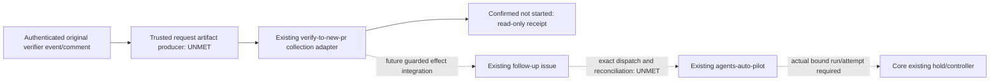

# Closer correction admission (collection only)

This extends the existing `agents-verify-to-new-pr.yml` entrypoint with a read-only
`workflow_dispatch` collection job. The label-triggered issue/autopilot path is
unchanged. **Actual corrective handoff is UNMET**: collection never creates an
issue, dispatches a workflow, or authenticates correction ownership acceptance.

The frozen inert fixture is
[`request.json`](../../tests/fixtures/verifier_correction/request.json).
The matching validator is `.github/scripts/verifier_correction_consumer.js`.
Canonical JSON is `verification_event.canonical` (sorted keys, UTF-8, no whitespace).
`request_sha256` hashes the request excluding itself; `receipt_sha256` hashes the
receipt excluding itself. Array order remains significant.

## Selector and authentication

`closer-correction-selector/v1` has exactly `schema`, `run_id`, `run_attempt`,
`artifact_id` (positive numeric selectors), `request_sha256`, `verification_event`
and `assessment_identity`. Selector fields are expectations, never provenance.
The consumer uses `acquireRetainedExecution` to authenticate the original verifier
workflow, canonical merged code origin, original run/attempt, job/step timeline,
artifact origin and archive digest. It then reads **only** the exact member
`closer-correction-request.json`. Missing members refuse admission, with no
fallback to caller request JSON, PR-number text or a generated model scope.

The retained manifest must hash to the original event's request/material identity.
Fresh API reads bind the merged PR head/base/merge, exact source and incumbent
issue node IDs/body hashes and current incumbent assignee. The original comment
must be the native GitHub Actions bot's exact PR comment and digest, contain one
NON_PASS decision, and match the original event/run/attempt/decision digest.
`verification_run_id` from the legacy follow-up ledger is not original identity.

## Request and receipt

`closer-correction-request/v1` binds the target, source issue, original verifier,
finding evidence, required tests, incumbent identity/assignment/lineage, original
hold/run/operation/idempotency/deadline/attempt budget/escalation owner and
`scope: substantive_implementation`. Unknown fields are refused. See the fixture
for exact field names. Required tests are data, never executable commands:

- `existing_selector`: ID/finding ID, source ref, relative test path, selector and
  physical file digest.
- `required_test_spec`: ID/finding ID, exact specification and source evidence
  ref/content digest equal to the finding evidence. This asks the coding lane to
  implement a test; it grants no mechanical ACT/test-success authority.

`closer-correction-receipt/v1` retains the whole request and consumer run/attempt.
It distinguishes `confirmed_not_started`,
`accepted_with_exact_issue_and_actual_autopilot_run_attempt`, and `outcome_unknown`.
Accepted shape requires the incumbent issue and an actual continuation's workflow,
run/attempt, request digest and issue node ID. Shape validation is not authentication
of continuation provenance. This adapter emits only `confirmed_not_started` for
its own effect-free collection. A validation refusal uses
`closer-correction-admission-refusal/v1`, hashes the untrusted selector, and refers
only to the current collection attempt. It proves nothing about prior effects.
All emitted receipts set retry/ACT/source-closure authority to false.

Receipts are uploaded in the existing `verifier-terminal-disposition` artifact:
`verifier-terminal-disposition.ndjson` carries the existing terminal schema with
an additive `correction_receipt`; `verifier-followup-ledger.ndjson` carries the
versioned correction receipt directly. Consumers must select by schema; legacy
ledger records cannot authenticate this correction protocol.

## Explicit integration gaps and ownership

Core owns Orchestrator #944's strict envelope and existing hold/controller consumer.
The Workflows consumer owner owns this helper, entrypoint and causal tests.
The consumer owner is also assigned the bounded producer hunk beside
`reusable-agents-verifier.yml`'s terminal event/comment generation and
`evaluation-results` / `comparison-results` uploads. It must produce the immutable
request member after the authenticated original terminal decision/comment. This
slice leaves the producer disabled because current verifier data lacks genuine
Closer hold/run/operation/idempotency/deadline/budget/escalation identities,
incumbent assignment/review lineage and explicit source-bound test requirements.
The core must identify their authenticated upstream source before they can be
retained. No caller JSON or model-generated replacement is accepted.
Gate/caller security surfaces are outside this slice.

Before enabling effects, integration must authenticate correction request authority
and source/finding/test evidence, incumbent assignment/review lineage, preserve
existing needs-human and chain-depth gates, enforce original deadline/attempt
budget, deduplicate exact authenticated requests durably, and reconcile uncertain
issue creation or continuation dispatch. The effect consumer must preserve an
unknown fence before a consequential call; a missing response, artifact or expired
budget never proves absence. Exact issue creation is not auto-pilot start. The
existing issue/autopilot lane must be reused with exact scope; no new scheduler,
provider or generic authority store is introduced here. Security/conflicting
requests require the separate qualified-owner path. No receipt clears NON_PASS,
resolves the finding, authorizes ACT, or grants source closure.

Validation uses inert source fixtures and API mocks. No provider calls, labels,
workflow dispatches, real follow-up issues or source closure are used in tests.

`reconcileCorrection` is a pure reducer over receipts already authenticated by
the existing artifact/event collector. It deduplicates exact accepted continuation
identities, rejects original idempotency-key rebinding and conflicting runs, and
retains unknown for missing/uncertain history. It is not an artifact collector,
new store or authorization to execute effects. Production effect transport and
its durable pre-effect fence remain blocked on authentic producer input.
