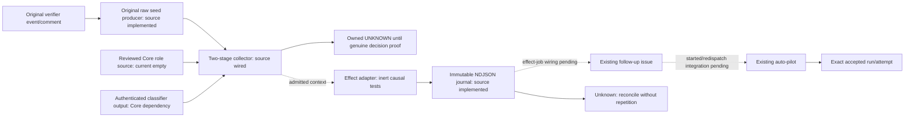

# Closer correction interface — local inert implementation

This bounded interface extends the existing merged-PR follow-up issue and
`agents-auto-pilot.yml` lane. **Production handoff remains UNMET**: authenticated
producer/collector, durable existing-ledger transport and actual auto-pilot started
receipt integration are pending. The collection-only workflow never invokes the
effect adapter. No new scheduler, provider, store or authority service is added.
All validation here uses inert fixtures/mocks; PR publication does not authorize
production effects or merging.

## Frozen local contract and fixtures

The validator is `.github/scripts/verifier_correction_consumer.js`; effect-side
logic is `.github/scripts/verifier_correction_effects.js`. All files under
[`tests/fixtures/verifier_correction`](../../tests/fixtures/verifier_correction/)
are synthetic, not claims about real GitHub provenance or workflow execution:

- `request.json`: unchanged existing-incumbent request.
- `no-incumbent-request.json`: declared `incumbent: {kind: "no_incumbent"}`;
  fabricates no issue ID, owner or assignment.
- `seed.json`: original verifier source/finding/event scope, excluding later
  Closer operation, incumbent and required-test decision fields.
- `no-incumbent-ownership.json`: synthetic trusted collector output.
- `accepted-no-incumbent-receipt.json`: synthetic exact issue/run/attempt receipt.

Canonical JSON uses `verification_event.canonical`: sorted keys, UTF-8, no
whitespace, significant array order. Request/receipt hashes exclude their own
`request_sha256` / `receipt_sha256` fields. Ledger record hashes likewise exclude
`record_sha256`. Declared requester context is bound by the request digest, never
promoted into externally attested Closer hold authorization.

`closer-correction-request/v1` binds target repository/PR/head/base/merge, linked
source issue node/body, original verifier event/run/attempt/comment/decision,
exact raw finding reference/content hash, typed required tests, declared incumbent,
original operation/hold/run/idempotency/deadline/budget/escalation and
`scope: substantive_implementation`. Unknown request fields are refused.

Required tests are data, never executable commands:

- `existing_selector`: ID/finding ID, immutable source ref, relative physical test
  path, selector and file hash.
- `required_test_spec`: ID/finding ID, exact implementation specification and
  source-evidence ref/content hash matching the finding evidence.

The later trusted collector authenticates these requirements against the actual
source-bound correction decision. The original verifier seed does not assert
future Closer operation IDs or future test specifications. The effect adapter
checks both the original seed and the separately collected required-test decision;
changing a request's test prose cannot bypass this check.

## Two-stage authentication and ownership

The original verifier cannot authenticate Closer IDs created after its terminal
result. It should retain a source finding/event seed beside its existing terminal
report/result artifacts. The existing correction workflow's trusted collector
then validates a bounded post-terminal request against that seed plus fresh
GitHub actor permissions, source/owner/assignment/review/run/policy facts.
Caller JSON booleans and declared local hold IDs supply no remote authority.

The trusted host output `closer-correction-ownership/v1` has `kind` equal to
`existing`, `no_incumbent` or `unknown`, plus `seed_effect_key`,
`source_scope_digest`, `observed_at`, `evidence_refs`, and an exact `incumbent`
only for `existing`. It is a result of authenticated collection, not an additional
caller input accepted as truth.

Existing requests must match the freshly observed exact issue/owner/assignment/
lineage. No-incumbent creation requires the explicit caller variant AND an
independently collected matching no-incumbent result. Complete linked follow-up
issue/open-PR/assignment/run and retained-effect history must show no incumbent,
unknown/starting/denied effect or competing work. Missing/unread/incomplete evidence
is unknown, never no-incumbent. Caller nulls and contradictory declarations refuse.

The effect key hashes the original event, raw finding evidence pointer/content,
source issue identity/body and scope. Caller request/hold/run/idempotency IDs,
display finding IDs and mutable assignment do not change it. `source_scope_digest`
binds target/source/raw finding/scope. These functions are frozen in the effect
helper; the shared fixture fixes their cross-language expected values.

## Existing issue/autopilot effects and reconciliation

The effect adapter has mandatory trusted-host dependencies and no live defaults:
original-seed/request/test-decision authentication, fresh facts, complete
existing-follow-up-ledger reads, durable conditional ledger append, authenticated
issue/started-receipt reconciliation, the existing GitHub client and a clock.
It is not imported by the collection-only Actions job.

Both fixed stages share one trusted effect key:

1. `issue_creation`: conditionally retain the exact intent before calling the
   existing issue endpoint once. Recover only one exact original issue/node/body
   marker through the trusted collector, then durably retain its identity.
2. `autopilot_dispatch`: after fresh created-issue/competing-work checks,
   conditionally retain the separate intent before calling existing
   `agents-auto-pilot.yml` with `issue_number` and `force_step=optimize` once.

Existing incumbents skip creation. Registry-derived agent/from/runner labels are
preserved; no generic model qualification creates authority. The typed creation
branch omits the `agents:auto-pilot` trigger label because explicit dispatch owns
activation; adding that label would also start a label-event run. The legacy
label-triggered issue/autopilot implementation is unchanged.

Every stage refuses to invoke an effect without a confirmed durable intent.
Conditional revision checks and a per-stage existing-intent check prevent duplicate
calls, including concurrent consumers advancing between issue retention and
dispatch. Shared token-aware API wrapping preserves the supplied scoped client;
consequential calls set both wrapper `maxRetries: 0` and SDK `request.retries: 0`
with a bounded timeout. This also disables the SDK retry layer documented by
[Octokit](https://github.com/octokit/plugin-retry.js/blob/main/src/error-request.ts). Lost intent acknowledgment invokes no endpoint. Unknown stage outcomes
never automatically repeat. An exact positively recovered issue permits the
first dispatch, not a replacement issue. Uncertain dispatch requires the actual
started receipt; HTTP204, issue creation, a run title or missing logs do not prove
acceptance. Later deadline expiry or refusal cannot erase an existing uncertainty.
The clock is checked before collection, after fresh gates and after intent
retention immediately before the consequential endpoint.

Fresh gates preserve the merged target, source/issue body and node identity,
incumbent assignment/lineage, pause/needs-human/failure labels, chain limit below
two, verdict policy, enabled registry agent where needed, write-capable dispatch
actor and complete competing-work inventory. Existing live incumbent work is
reconciled without dispatching a second writer. Security/conflicting-authority
scope remains outside this substantive correction lane.

`closer-correction-receipt/v1` distinguishes `confirmed_not_started`,
`accepted_with_exact_issue_and_actual_autopilot_run_attempt` and `outcome_unknown`.
It retains the original declared request/digest and consumer run/attempt. An
additive `ownership` contains the trusted collector's bound proof context. For
no-incumbent ownership, actual created issue/node may differ from the declared
request, which contains no invented issue identity. Plain legacy receipts retain
existing-incumbent equality. Shape validation is not provenance authentication:
the host must authenticate collector and started-artifact run/attempt/origin.
All receipts set retry/ACT/source-closure authority to false. No handoff clears
NON_PASS, resolves the finding or proves required-test success.

## Intermediate collection entrypoint and integration gaps

The existing `agents-verify-to-new-pr.yml` accepts the original
`closer-correction-selector/v1` plus optional bounded `correction_request` and
`correction_decision` JSON inputs. The two-stage collector authenticates the
original artifact through `acquireRetainedExecution`, reproduces every raw seed
from retained output, original execution receipt, native terminal comment and
current GitHub subject/source APIs, and verifies physical existing-test hashes at
an exact subject commit. It retains its own `closer-correction-admitted/v1`
context in `verifier-correction-admitted-RUN-ATTEMPT`. The earlier selector-only
single-artifact collection path is retained as an intermediate compatibility path.

The original producer now writes `closer-correction-seeds.json` beside the
existing evaluate/compare artifacts after authentic terminal publication. It
asserts only original event/run/attempt/comment, raw finding and exact source/PR
identity. It never asserts future hold, operation, owner or required-test data.
Ambiguous retained source, unavailable provider slots, absent explicit findings
or changed source bytes produce a bounded refusal, not invented evidence.

`verifier_correction_profile.py` reads a literal-only view of the existing
`stranske/Orchestrator` `src/closer_role_qualification.py` registry. The host fixes
repository/default reviewed ref, fetches an exact commit and verifies Git blob
integrity. The parser never imports or executes fetched code. A reviewed-reader
AST fingerprint excludes only the registry literal; changed semantics, dynamic or
ambiguous source, revoked/expired records and the current empty registry remain
UNKNOWN. This is role-record eligibility, not runtime/provider confinement proof.
Core independently compared the shared 16-case fixture against its actual
`qualification_problems` reader: 16 matches, zero mismatches. The fixture SHA256 is
`bad0bbd5dbe2e3c8a621043f4c10b67373a0c57d437b97fc9c6b1d09bbf3ba72`.

Qualification does not prove a profile emitted supplied classification JSON.
The collector therefore separately requires a trusted retained-I/O decision
verifier, binding decision digest and exact profile identity. That Core supervised
execution/native collector join is not available yet; nonempty caller evidence
references cannot substitute. The workflow currently passes no such verifier and
therefore retains owned UNKNOWN contexts, even if a future registry record exists.
Security/authority-conflict/uncertain findings never enter generic auto-pilot.

The Actions-artifact transport and NDJSON journal implementation are now source
code with inert causal tests. Each stage uploads a fixed immutable checkpoint and
checks actual canonical workflow/run/attempt/job/step/archive/member provenance
and exact readback before effects. Complete retained history, contiguous revisions
and first-request limits are required. Missing/deleted historical checkpoints
remain UNKNOWN unless the exact historical effect job was positively skipped;
expiry, forks, duplicates and upload uncertainty cannot imply absence. These
artifacts require the authenticated PR concurrency host integration; they are not
a new store or a cross-workflow lock. The source effect-job wiring, complete fresh
ownership collector, and actual auto-pilot started/redispatch receipt integration
remain outstanding. Source collection and inert kernel tests are not a completed
or deployed handoff. Core retains Orchestrator #944 integration ownership; Gate
and caller hardening remain outside this slice.

## Local validation checkpoint

The correction suites contain 71 passing JavaScript tests plus 33 Python
qualification source-reader tests. All consequential effects are inert; artifact
transport tests use independently generated ZIPs and mock Actions/SDK boundaries. Cases
include accepted existing and no-incumbent requests, deterministic refusal,
HTTP204 versus actual run identity, uncertain create/dispatch, exact issue recovery,
restart, lost checkpoint acknowledgments, changed caller IDs, complete fresh
ownership/labels/work inventory, deadline changes and concurrent requests.
Ten concurrent consumers produce one issue and one dispatch in the inert fixture.

Local adversarial review found and fixed incomplete work-inventory admission,
invalid consumer identity before invocation, post-intent deadline expiry, malformed
prior-started proof handling, and a possible second-stage race after concurrent
issue retention. Independent read-only review additionally found a copied-marker
issue substitution and regex coercion of digest arrays; both were fixed and
regression-tested, including accepted-continuation binding and strict scalar types.
Final source mutants detect removal of the fixed-stage fence,
durable intent and current-assignee check; the unmodified source remains green.
No production issue, label, workflow dispatch, provider call or source closure
is exercised by these tests.

Hosted scanner review tightened the new checkout with `persist-credentials: false`
and corrected the artifact action pin/version. The local composite `./` reference
is intentional: it resolves from the explicit Workflows checkout in consumers,
whereas self-repository syntax would select the consumer repository/version. The
path-join audit annotation is a false positive: `directory` is the host workspace
literal `'.'`, never selector input; the filename is fixed and the authenticated
helper just created it using `wx`. These boundaries were independently reviewed;
no broad suppression, hosted alert dismissal or security-policy change is made.

The current integration checkpoint additionally covers original raw-seed
production, two-stage collection, role-source integrity, deleted/expired/forked
checkpoint history and post-checkpoint fresh admission gates. Hosted Python checks
on the previous PR head exposed stale generated Renovate ownership paths and a
hardcoded managed-entry count; both are corrected locally with focused regression
checks before publication. Hosted status must be read at the next exact PR head.
