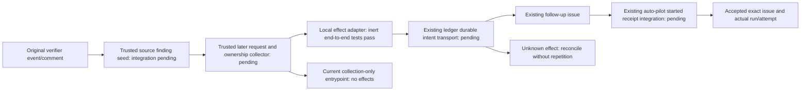

# Closer correction interface — local inert implementation

This bounded interface extends the existing merged-PR follow-up issue and
`agents-auto-pilot.yml` lane. **Production handoff remains UNMET**: authenticated
producer/collector, durable existing-ledger transport and actual auto-pilot started
receipt integration are pending. The collection-only workflow never invokes the
effect adapter. No new scheduler, provider, store or authority service is added.
Publication is explicitly on hold; all validation here uses inert fixtures/mocks.

## Frozen local contract and fixtures

The validator is `.github/scripts/verifier_correction_consumer.js`; effect-side
logic is `.github/scripts/verifier_correction_effects.js`. All files under
[`tests/fixtures/verifier_correction`](../../tests/fixtures/verifier_correction/)
are synthetic, not claims about real GitHub provenance or workflow execution:

- `request.json`: unchanged existing-incumbent request.
- `no-incumbent-request.json`: declared `incumbent: {kind: "no_incumbent"}`;
  fabricates no issue ID, owner or assignment.
- `seed.json`: original verifier source/finding/event scope, excluding later
  Closer operation, incumbent and required-test decision fields.
- `no-incumbent-ownership.json`: synthetic trusted collector output.
- `accepted-no-incumbent-receipt.json`: synthetic exact issue/run/attempt receipt.

Canonical JSON uses `verification_event.canonical`: sorted keys, UTF-8, no
whitespace, significant array order. Request/receipt hashes exclude their own
`request_sha256` / `receipt_sha256` fields. Ledger record hashes likewise exclude
`record_sha256`. Declared requester context is bound by the request digest, never
promoted into externally attested Closer hold authorization.

`closer-correction-request/v1` binds target repository/PR/head/base/merge, linked
source issue node/body, original verifier event/run/attempt/comment/decision,
exact raw finding reference/content hash, typed required tests, declared incumbent,
original operation/hold/run/idempotency/deadline/budget/escalation and
`scope: substantive_implementation`. Unknown request fields are refused.

Required tests are data, never executable commands:

- `existing_selector`: ID/finding ID, immutable source ref, relative physical test
  path, selector and file hash.
- `required_test_spec`: ID/finding ID, exact implementation specification and
  source-evidence ref/content hash matching the finding evidence.

The later trusted collector authenticates these requirements against the actual
source-bound correction decision. The original verifier seed does not assert
future Closer operation IDs or future test specifications. The effect adapter
checks both the original seed and the separately collected required-test decision;
changing a request's test prose cannot bypass this check.

## Two-stage authentication and ownership

The original verifier cannot authenticate Closer IDs created after its terminal
result. It should retain a source finding/event seed beside its existing terminal
report/result artifacts. The existing correction workflow's trusted collector
then validates a bounded post-terminal request against that seed plus fresh
GitHub actor permissions, source/owner/assignment/review/run/policy facts.
Caller JSON booleans and declared local hold IDs supply no remote authority.

The trusted host output `closer-correction-ownership/v1` has `kind` equal to
`existing`, `no_incumbent` or `unknown`, plus `seed_effect_key`,
`source_scope_digest`, `observed_at`, `evidence_refs`, and an exact `incumbent`
only for `existing`. It is a result of authenticated collection, not an additional
caller input accepted as truth.

Existing requests must match the freshly observed exact issue/owner/assignment/
lineage. No-incumbent creation requires the explicit caller variant AND an
independently collected matching no-incumbent result. Complete linked follow-up
issue/open-PR/assignment/run and retained-effect history must show no incumbent,
unknown/starting/denied effect or competing work. Missing/unread/incomplete evidence
is unknown, never no-incumbent. Caller nulls and contradictory declarations refuse.

The effect key hashes the original event, raw finding evidence pointer/content,
source issue identity/body and scope. Caller request/hold/run/idempotency IDs,
display finding IDs and mutable assignment do not change it. `source_scope_digest`
binds target/source/raw finding/scope. These functions are frozen in the effect
helper; the shared fixture fixes their cross-language expected values.

## Existing issue/autopilot effects and reconciliation

The effect adapter has mandatory trusted-host dependencies and no live defaults:
original-seed/request/test-decision authentication, fresh facts, complete
existing-follow-up-ledger reads, durable conditional ledger append, authenticated
issue/started-receipt reconciliation, the existing GitHub client and a clock.
It is not imported by the collection-only Actions job.

Both fixed stages share one trusted effect key:

1. `issue_creation`: conditionally retain the exact intent before calling the
   existing issue endpoint once. Recover only one exact original issue/node/body
   marker through the trusted collector, then durably retain its identity.
2. `autopilot_dispatch`: after fresh created-issue/competing-work checks,
   conditionally retain the separate intent before calling existing
   `agents-auto-pilot.yml` with `issue_number` and `force_step=optimize` once.

Existing incumbents skip creation. Registry-derived agent/from/runner labels are
preserved; no generic model qualification creates authority. The typed creation
branch omits the `agents:auto-pilot` trigger label because explicit dispatch owns
activation; adding that label would also start a label-event run. The legacy
label-triggered issue/autopilot implementation is unchanged.

Every stage refuses to invoke an effect without a confirmed durable intent.
Conditional revision checks and a per-stage existing-intent check prevent duplicate
calls, including concurrent consumers advancing between issue retention and
dispatch. Lost intent acknowledgment invokes no endpoint. Unknown stage outcomes
never automatically repeat. An exact positively recovered issue permits the
first dispatch, not a replacement issue. Uncertain dispatch requires the actual
started receipt; HTTP204, issue creation, a run title or missing logs do not prove
acceptance. Later deadline expiry or refusal cannot erase an existing uncertainty.
The clock is checked before collection, after fresh gates and after intent
retention immediately before the consequential endpoint.

Fresh gates preserve the merged target, source/issue body and node identity,
incumbent assignment/lineage, pause/needs-human/failure labels, chain limit below
two, verdict policy, enabled registry agent where needed, write-capable dispatch
actor and complete competing-work inventory. Existing live incumbent work is
reconciled without dispatching a second writer. Security/conflicting-authority
scope remains outside this substantive correction lane.

`closer-correction-receipt/v1` distinguishes `confirmed_not_started`,
`accepted_with_exact_issue_and_actual_autopilot_run_attempt` and `outcome_unknown`.
It retains the original declared request/digest and consumer run/attempt. An
additive `ownership` contains the trusted collector's bound proof context. For
no-incumbent ownership, actual created issue/node may differ from the declared
request, which contains no invented issue identity. Plain legacy receipts retain
existing-incumbent equality. Shape validation is not provenance authentication:
the host must authenticate collector and started-artifact run/attempt/origin.
All receipts set retry/ACT/source-closure authority to false. No handoff clears
NON_PASS, resolves the finding or proves required-test success.

## Intermediate collection entrypoint and integration gaps

The existing `agents-verify-to-new-pr.yml` has an optional read-only dispatch
collection job. Its current `closer-correction-selector/v1` contains exact
run/attempt/artifact selectors, request digest, original event and assessment.
It reuses `acquireRetainedExecution`, checks archive digest, original manifest,
current API identities and native original decision comment, then emits only a
collection receipt. Its earlier single-artifact request expectation is an
**intermediate**; declared no-incumbent requests explicitly require the later
two-stage collector. Missing members have no caller-JSON/PR-text/model fallback.

The existing terminal artifact carries collection data in
`verifier-terminal-disposition.ndjson` with additive `correction_receipt`, and
`verifier-followup-ledger.ndjson` with the versioned correction receipt. Validation
refusals use `closer-correction-admission-refusal/v1` and hash the untrusted selector.
A refusal describes only that collection attempt, never prior-effect absence.
Consumers must distinguish these schemas from legacy follow-up ledger records.

Core owns Orchestrator #944's strict envelope and existing hold/controller
integration. The Workflows owner also has the original seed-producer hunk beside
`reusable-agents-verifier.yml` terminal report/artifact generation; its field
mapping is coordinated with core. The separate auto-pilot hunk belongs in
`templates/consumer-repo/.github/workflows/agents-auto-pilot.yml` (manifest
`source_tree: template`), aligned with the operational counterpart: optional
correlation inputs, trusted admitted-artifact validation, started receipt after
context/cycle/next-step gates, and explicit redispatch correlation. No auto-pilot
source or Gate/caller security files are changed by this local slice.

The conditional ledger API is a narrow required host transport, not an implemented
durable store. Existing NDJSON artifact upload alone supplies neither CAS nor a
pre-effect durable intent. That property and the actual provenance transports
must be implemented/verified before connecting the effect helper. Current
collection-only source is not a completed or deployed handoff.

## Local validation checkpoint

The two correction suites contain 38 passing tests: 10 contract/admission tests
and 28 effect tests. All external effects are synthetic in-memory clients. Cases
include accepted existing and no-incumbent requests, deterministic refusal,
HTTP204 versus actual run identity, uncertain create/dispatch, exact issue recovery,
restart, lost checkpoint acknowledgments, changed caller IDs, complete fresh
ownership/labels/work inventory, deadline changes and concurrent requests.
Ten concurrent consumers produce one issue and one dispatch in the inert fixture.

Local adversarial review found and fixed incomplete work-inventory admission,
invalid consumer identity before invocation, post-intent deadline expiry, malformed
prior-started proof handling, and a possible second-stage race after concurrent
issue retention. Final source mutants detect removal of the fixed-stage fence,
durable intent and current-assignee check; the unmodified source remains green.
No separate external/provider reviewer is claimed. No production issue, label,
workflow dispatch, provider call or source closure is exercised, and no publication
is performed.
